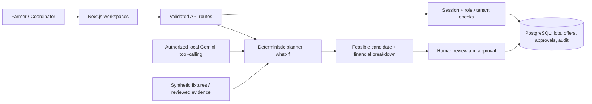

<div align="center">

# AgriRoute AI

### Evidence-led harvest-to-market decision support

**Commit for Good · Research prototype**

A transparent system for comparing **SELL NOW**, **STORE**, and **REROUTE** decisions using explicit assumptions, deterministic calculations, and reviewable evidence.

[**Explore the live prototype**](https://agri-route-ai.vercel.app) · [**System architecture**](docs/ARCHITECTURE.md) · [**Project structure**](docs/PROJECT_STRUCTURE.md) · [**Run locally**](docs/LOCAL_DEVELOPMENT.md) · [**Evaluation**](docs/EVALUATION.md) · [**Deployment and limits**](docs/DEPLOYMENT_AND_LIMITATIONS.md)

</div>

---

> [!IMPORTANT]
> **Research prototype, not a live agricultural advisory or booking service.** The original benchmark and Mandi Lab use explicitly **synthetic data**. Weather/route evidence used by the separate local Live Assisted workflow has operational limits. Estimates are not realized farmer earnings. Some features work locally but are intentionally restricted on Vercel; see [deployment boundaries](docs/DEPLOYMENT_AND_LIMITATIONS.md).

## The research question

**Which harvest decision produces the best feasible expected net proceeds—not merely the highest quoted price?**

A higher market price may be offset by transport, storage fees, delay, quality loss, and the remaining usable life of produce. AgriRoute evaluates those trade-offs while retaining a human review step for operational decisions.

## Explore the workspaces

| Workspace | What it demonstrates | Current boundary |
| --- | --- | --- |
| [**Demo Lab**](https://agri-route-ai.vercel.app/demo) | Interactive seed-42 lots, maps, eligibility, candidate comparisons, sensitivity analysis, saved trace inspection | Frozen synthetic research data; not live prices |
| [**Mandi Lab**](https://agri-route-ai.vercel.app/mandi) | Reproducible fictional market series, forecasts, scenario planning, and illustrated buyer terms | Clearly labelled synthetic market data; hosted anonymous offer writes are disabled |
| [**Live Assisted**](https://agri-route-ai.vercel.app/live) | Separate Jaipur-tomato weather/road evidence workflow with explicit input assumptions | Hosted provider refresh/recalculation currently locked; full local workflow is separate |
| [**Coordinator**](https://agri-route-ai.vercel.app/coordinator) | Role-restricted lot planning, buyer-term review, approval and audit trail | Requires configured PostgreSQL and an authorized account |
| [**Farmer View**](https://agri-route-ai.vercel.app/farmer) | Hindi projection of an assigned, approved decision | Not an anonymous public record; authenticated access required |

## System at a glance



Gemini is a **bounded decision-selection layer**, not the source of invented financial figures: the server validates tools, candidate eligibility, calculated amounts, and saved trace provenance. One authentic shared-capacity tool-calling run is documented; a comparable full 30-lot Gemini cohort has **not** been completed. [Architecture and trust boundaries →](docs/ARCHITECTURE.md)

## Repository map

```text
app/             Next.js pages and server API routes
components/      Interactive demo, coordinator, farmer, live and mandi UI
lib/             Planning, simulation, tool calling, authorization and storage
data/            Frozen seed-42 world and separate synthetic Mandi fixtures
scripts/         Setup, fixture checks, replay and evaluation tools
tests/           Node tests plus Playwright browser journeys
public/          Bundled UI asset and frozen public evaluation artifacts
docs/            Architecture, structure, local setup and research notes
```

[**Explore the annotated file structure →**](docs/PROJECT_STRUCTURE.md)

## Quick start

**Requirements:** Node.js 24, npm, and PostgreSQL for coordinator workflows. The optional fresh-database helper supports a local Homebrew PostgreSQL installation on Apple Silicon.

```bash
git clone https://github.com/bug1857/AgriRoute-AI.git
cd AgriRoute-AI
npm ci
cp .env.example .env.local
# Configure your own local DATABASE_URL, or follow the fresh macOS setup guide.
npm run dev
```

Open **http://127.0.0.1:3010**. Do not overwrite an existing `.env.local` or reinitialize an existing PostgreSQL cluster. See [local setup, database initialization, and test prerequisites](docs/LOCAL_DEVELOPMENT.md) before running account workflows.

## Experimental evidence

The public frozen evaluation compares a nearest-market baseline (**Policy A**) with the deterministic feasible planner (**Policy B**) across the same **30 synthetic lots over 30 simulated days**.

| Frozen evaluation metric | Policy A | Policy B |
| --- | ---: | ---: |
| Realized simulated net proceeds | ₹2,929,253.23 | ₹2,947,630.19 |
| Modeled spoiled produce | 12,258.67 kg | 15,422.10 kg |
| Cohort completion | 30/30 | 30/30 |

Policy B yields **₹18,376.96 more simulated net proceeds**, **alongside 3,163.43 kg more modeled spoilage**. This is not a claim of reduced food waste or measured field impact.

**Policy C (Gemini): incomplete at 1/30.** The authentic run demonstrates bounded tool calls and server-validated candidate selection, but a comparable full-cohort Gemini uplift has **not** been established.

The last fully integrated local verification (11 October 2026) reported **97/97 Node tests** and **14/14 Playwright browser tests** passing, plus typecheck, build and frozen-evaluation checks. These are *local test results*, not production-service acceptance.

[**Experiment design, provenance, commands and limitations →**](docs/EVALUATION.md)

## Documentation

| Guide | What you will find |
| --- | --- |
| [Architecture](docs/ARCHITECTURE.md) | Component diagram, API boundaries, role-restricted workflow, Gemini tool-calling and evidence flow |
| [Project structure](docs/PROJECT_STRUCTURE.md) | Actual folders and the purpose of the major modules |
| [Local development](docs/LOCAL_DEVELOPMENT.md) | Requirements, safe database setup, running the server and test commands |
| [Evaluation and reproducibility](docs/EVALUATION.md) | Frozen A/B results, trace coverage, independent checks and research caveats |
| [Deployment and limitations](docs/DEPLOYMENT_AND_LIMITATIONS.md) | Vercel/Neon configuration, hosted restrictions and remaining acceptance gates |

Earlier checkpoint and implementation notes remain in the repository as historical evidence; they are not automatically up-to-date production-status statements.

## Responsible use and licensing

- The application keeps provider keys, passwords, signing material, private evidence receipts and local PostgreSQL files **outside Git**. Never commit `.env.local` or `private/`.
- Hosted Gemini generation, public authentic traces, anonymous memory-backed offer writes, and hosted Live Assisted refresh remain disabled until the required durable, authenticated implementation and verification exist.
- See [`LICENSE_SCOPE.md`](LICENSE_SCOPE.md) and [`ACKNOWLEDGEMENTS.md`](ACKNOWLEDGEMENTS.md). The repository's MIT grant covers only the original source code for which its owner has licensing rights; third-party assets, services, dependencies, datasets and non-code materials retain their own terms.

**Repository:** [github.com/bug1857/AgriRoute-AI](https://github.com/bug1857/AgriRoute-AI) · **Prototype:** [agri-route-ai.vercel.app](https://agri-route-ai.vercel.app)
