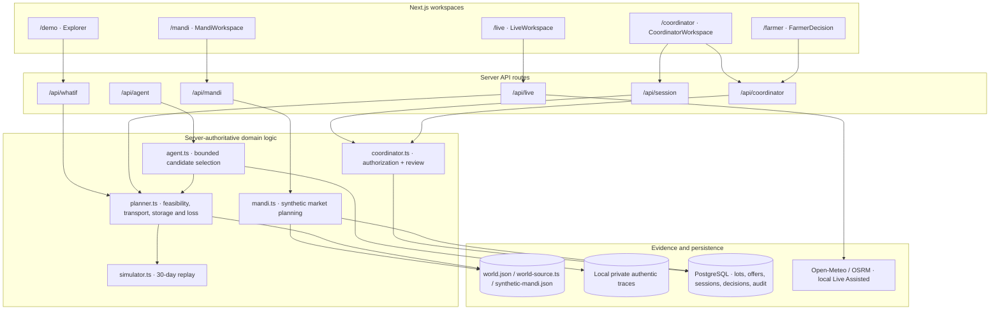
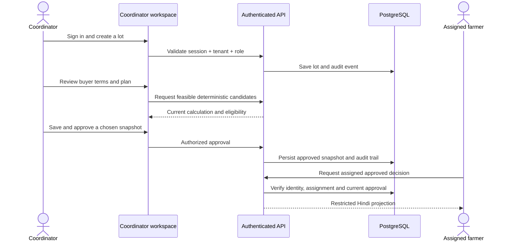

# System architecture

[← README](../README.md) · [Project structure](PROJECT_STRUCTURE.md) · [Local setup](LOCAL_DEVELOPMENT.md) · [Research evidence](EVALUATION.md) · [Deployment](DEPLOYMENT_AND_LIMITATIONS.md)

AgriRoute AI combines a Next.js/React interface with deterministic planning, provenance-sensitive AI tool use, and a PostgreSQL-backed human-approval workflow. The diagram shows **implemented module families**; it does not imply that every capability has been enabled on public Vercel.

## Component and data flow

The arrows indicate logical code relationships, not universal production availability. For example, the authenticated coordinator can plan with synthetic Mandi data via server logic; public Mandi POST does not require or use Gemini. The original frozen simulator and the separate Mandi Lab are not the same dataset.

## Main layers

| Layer | Implemented files | Responsibility |
| --- | --- | --- |
| UI | `app/*/page.tsx`, `components/*.tsx` | Navigation, visualizations, scenario controls, coordinator review and authorized farmer projection |
| API boundary | `app/api/*/route.ts`, `lib/local-api.ts` | Request validation, local/hosted origin handling, response status and bounded body parsing |
| Decisions | `lib/planner.ts`, `lib/whatif.ts`, `lib/mandi.ts` | Feasible candidate construction, risk gates, sensitivity and server-owned financial calculations |
| Evaluation | `lib/simulator.ts`, `lib/simulation-replay.ts`, `lib/evaluation-capture.ts` | Shared-capacity simulation, repeatable settlement, contextual trace verification and manifest generation |
| AI and evidence | `lib/agent.ts`, `lib/gemini-server.ts`, `lib/agent-store.ts` | Five-function bounded Gemini calls, explicit provider authorization, trace integrity and local replay |
| Durable workflows | `lib/coordinator.ts`, `lib/database.ts`, `lib/farmer-record.ts` | Session authorization, tenant/role checks, lot and offer records, immutable approvals and Hindi views |

## Human-authorized workflow

The UI does **not** turn unconfirmed buyer text directly into an authoritative transaction. The persistent Coordinator workflow applies human Confirm/Correct/Reject/Withdraw review and authorization checks. The simpler anonymous offer parser uses temporary server memory locally and is **not** an authenticated persisted cloud workflow.

## Gemini's precise role

1. The authorized local model uses the official `@google/genai` SDK, configured for `gemini-3.1-flash-lite`.
2. Its available tools cover price forecast, weather, storage, spoilage and transport; the authoritative tool results come from server functions.
3. Gemini may choose an eligible candidate ID, but cannot override hard constraints or invent financial totals accepted by the planner.
4. Recorded tool arguments/results and the final selected ID are validated against the exact input and context before replay; local HMAC integrity is not a Google-issued signature.
5. One shared-capacity authentic run is documented. **29 of 30 sequential decisions are not completed**, so full Policy C comparisons are withheld.
6. Public hosted inference and private trace access are intentionally blocked. No provider call should be made for routine tests or synthetic demo use.

See [`ONE-LOT-VERIFICATION.md`](../ONE-LOT-VERIFICATION.md) for the authentic bounded run and [evaluation](EVALUATION.md) for valid conclusions.

## Security and deployment boundaries

`lib/local-api.ts` checks exact host and Origin policy for local/hosted requests. The deployed build allows public synthetic planning for authorized same-origin requests, but returns **HTTP 423** for serverless-unsafe public writes: hosted `POST /api/live`, hosted `POST /api/agent`, and anonymous hosted `POST /api/offers`. Authenticated Coordinator data is PostgreSQL-backed; it requires separate production database and account acceptance.

**Read:** [Deployment, configuration and unresolved production gates →](DEPLOYMENT_AND_LIMITATIONS.md)
